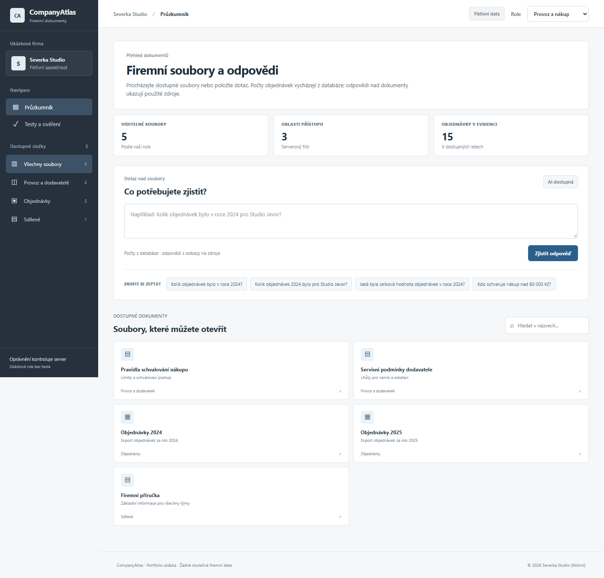

# CompanyAtlas

[Česky](#česky) · [English](#english)

## Česky

**Průzkumník fiktivních firemních souborů s přesnými datovými odpověďmi, AI souhrny a přístupem podle role.** CompanyAtlas ukazuje, jak bezpečně propojit vyhledávání v dokumentech s výpočtem nad tabulkou objednávek. Výsledek vždy odkazuje na zdrojový soubor; u objednávek také na konkrétní řádky.



### Ukázkový scénář

Fiktivní Severka Studio má 9 souborů a 15 objednávek. Dotaz „Kolik objednávek bylo v roce 2024?“ vrátí **12**, z toho 11 dokončených a 1 stornovanou. Dotaz na Studio Javor vrátí **5**, z toho 4 dokončené a 1 stornovanou. Stornované objednávky jsou v celkovém počtu výslovně zahrnuté. „Novák“ odpovídá dvěma zákazníkům, proto aplikace žádá o upřesnění.

### Co aplikace předvádí

- **Průzkumník souborů:** složky, hledání v názvech i obsahu a otevření zdrojového CSV nebo textového dokumentu. Server filtruje výsledky podle aktuální role ještě před hledáním a vrací pouze metadata.
- **Přesné výpočty:** dotazy na počet a hodnotu objednávek zpracovávají parametrizované SQLite dotazy, nikoli odhad jazykového modelu.
- **AI odpovědi nad texty:** server předá OpenAI pouze relevantní povolené dokumenty. AI musí vrátit doslovné citáty; server ověří jejich výskyt ve zdrojích a odmítne neplatné odkazy. Citát sám o sobě ještě nedokazuje správnost interpretace.
- **Role:** provoz a nákup vidí objednávky, dodavatele a sdílené soubory; péče o lidi vidí personální a sdílené soubory; vedení vidí vše. Přístup se kontroluje na serveru před vyhledáváním i při otevření souboru.
- **QA a audit:** osm kontrolních scénářů pro přesnost a přístupová pravidla, čtrnáct automatizovaných testů a protokol událostí bez ukládání textu dotazů.
- **Předání výsledku:** viditelnou odpověď lze stáhnout jako text se zdroji a započítanými řádky. Rozklikávací panel vysvětluje technologii, práci s API a hranice ukázkových rolí.

### Spuštění

Vyžaduje Python 3.13 nebo novější; aplikace používá pouze standardní knihovnu. Na Windows:

```powershell
python server.py
```

Otevřete [http://127.0.0.1:4182](http://127.0.0.1:4182). Fiktivní data a přesné výpočty fungují bez API klíče. Pro AI souhrny vytvořte ignorovaný `.env.local` podle `.env.example` s `OPENAI_API_KEY`, nebo nastavte proměnnou v prostředí procesu. Klíč čte pouze místní server a **nepatří na GitHub**.

```powershell
python -m unittest discover -s test -v
```

Při prvním spuštění se z `sample_data/` vytvoří místní SQLite databáze v ignorované složce `data/`. Pro opětovné načtení změněných ukázkových souborů lze při zastaveném serveru odstranit pouze vygenerovaný soubor `data/companyatlas.sqlite` a spustit server znovu.

### Důležité hranice

Účty jsou **demonstrace rolí bez hesla**: každý návštěvník si může vybrat všechny role. Projekt proto nesmí dostat skutečné firemní dokumenty ani být veřejně vystaven jako zabezpečený interní systém. Místní server naslouchá jen na `127.0.0.1`; pro reálné nasazení by bylo nutné přidat autentizaci, skutečné identity a oprávnění ze zdrojových systémů.

První verze indexuje připravené CSV a Markdown soubory. Nepřijímá nahrané soubory, PDF ani DOCX, neumí obecné SQL dotazy a nepamatuje si návaznost mezi dotazy. Textové odpovědi jsou omezené na dostupné podklady a mohou obsahovat chybnou interpretaci; důležité závěry je nutné ověřit ve zdrojích. Při AI dotazu se vybrané fiktivní úryvky odešlou OpenAI API. Požadavek používá `store: false`; server omezuje AI na dvě souběžná a 20 volání za 24 hodin v rámci běžícího procesu.

Podrobné výsledky jsou v [ověření](docs/QA.md) a [zadání projektu](docs/PROJECT.md).

## English

**A fictional company file explorer with exact data answers, AI-assisted document summaries, and role-based access.** CompanyAtlas combines source-aware document search with deterministic calculations over an orders table. Answers link back to source files and, for order counts, exact CSV rows.

The sample company contains 9 files and 15 orders. A question about 2024 orders returns **12**, including one cancelled order. A question about Studio Javor returns **5**. An ambiguous customer name prompts for clarification.

### Features

- Browse and search titles and contents of files allowed for the selected demo role; open their original CSV or Markdown content. Search returns metadata only.
- Answer order-count and order-value questions with parameterized SQLite queries. The language model does not calculate these totals.
- Summarize accessible documents with OpenAI. The model supplies verbatim evidence quotes, which the server checks against the authorized source files.
- Demonstrate backend access checks for operations, people, and leadership roles, plus eight built-in QA scenarios and an audit trail that omits question text.
- Download the visible answer with its authorized sources and counted rows as a text file. An expandable note explains the stack, API use, and demo-role limitations.

### Run and test

Python 3.13+; no third-party packages.

```sh
python server.py
python -m unittest discover -s test -v
```

Open [http://127.0.0.1:4182](http://127.0.0.1:4182). The sample and exact counts work without an API key. AI summaries require `OPENAI_API_KEY` in the process environment or an ignored local `.env.local` file based on `.env.example`. Never commit a real key.

### Scope and security

**The role selector is a demo, not real authentication.** Anyone using the local app can select leadership, so use fictional data only. The server binds to loopback and must not be exposed publicly with real company files or a metered API key. A production version would need authenticated identities, permissions inherited from the source systems, and persistent usage controls.

This version indexes prepared CSV and Markdown files only. It has no upload, PDF/DOCX parsing, general SQL generation, or multi-turn chat memory. AI evidence quotes are checked for exact occurrence, but a human must still verify their meaning. See [QA evidence](docs/QA.md) and [project scope](docs/PROJECT.md).
