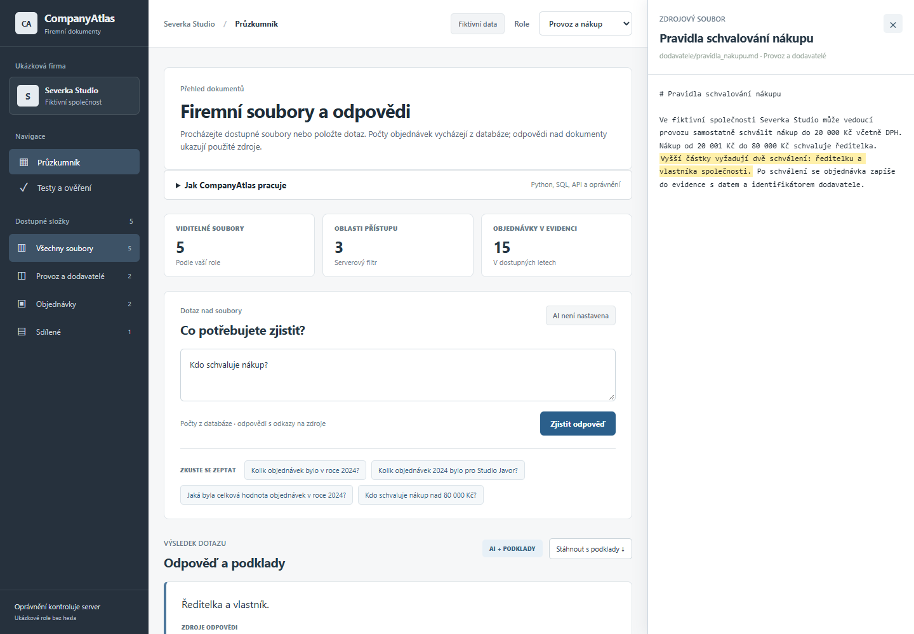

# CompanyAtlas

**Průzkumník fiktivních firemních souborů: přesné SQL odpovědi, AI souhrny s citacemi a přístup podle přihlášeného účtu.**



## Co řeší

Provoz potřebuje spočítat objednávky a dohledat nákupní postup. Personální oddělení potřebuje vlastní dokumenty. Aplikace odděluje přístup na serveru a u odpovědi ukazuje podklad. Fiktivní Severka Studio má ve výchozí sadě 9 souborů a 15 objednávek. Dotaz na rok 2024 vrátí 12 objednávek včetně jedné stornované; Studio Javor má 5. Nejednoznačné jméno vyžaduje upřesnění.

## Používání

1. Přihlaste se účtem operations, people nebo leadership. **Veřejné demonstrační heslo všech tří: AtlasDemo-2026. Pouze fiktivní data.** Účet má pevnou roli, klient si nepřiděluje oprávnění.
2. Procházejte složky nebo hledejte v názvech a obsahu. Otevřete boční náhled a položte otázku. Počty a hodnoty objednávek počítá parametrizované SQL; AI je nesčítá. Průměry, mediány a nepodporované časové dotazy vyžadují upřesnění.
3. Textové odpovědi používají volitelně OpenAI Responses API. Odesílají se nejvýše tři již povolené úryvky. Server kontroluje doslovné citace a verzi zdroje po návratu odpovědi. Výskyt citátu sám nepotvrzuje správnost interpretace.
4. Vedení může ve správě nahrát textové PDF, DOCX, TXT nebo MD; zvolit oblast, nahradit aktuální verzi a dokument odebrat. Strany/odstavce se zobrazují u citace. Verze brání otevření starého zdroje; aplikace **neuchovává úplný archiv starších verzí**.
5. Vedení může deaktivovat jiný ukázkový účet. Server okamžitě odmítne jeho relace. Otevřený prohlížeč při další kontrole (každých 5 sekund a při návratu do okna) vymaže obsah. Již stažené kopie odebrat nelze.

Provoz vidí objednávky, dodavatele a sdílené dokumenty. People vidí personální a sdílené soubory. Vedení vidí vše. Přepnutí účtu vyžaduje nové přihlášení a odstraní předchozí pracovní obsah. Odpověď lze stáhnout včetně zdrojů.

## Technologie a datový tok

Python 3.13+, SQLite, standardní HTTP server, HTML/CSS/JavaScript. Text PDF čte **pypdf 6.21.4**; DOCX se čte přes omezený ZIP a XML standardní knihovny. Samostatný proces má časový limit 15 sekund a nepřebírá proměnnou OPENAI_API_KEY. Ukládá se jen textový index, lokátory, verze a SHA-256; původní binární příloha se neukládá. Při změně dokumentu se v jediné transakci aktualizuje index a revize katalogu. Klient změnu zachytí při další kontrole a odstraní staré podklady.

Limity: 2 MB vstup, 30 importovaných dokumentů, 50 stran PDF, 100 000 znaků / 2 000 fragmentů; DOCX nejvýše 256 ZIP položek a 8 MB deklarovaného rozbalení. PDF má i omezení dekódování, stromu stran a objektů podle [pypdf Configuration](https://pypdf.readthedocs.io/en/6.21.4/modules/configuration.html). Sken bez textu vyžaduje OCR a je odmítnut. Texty ani odkazy ze souborů se nespouštějí. Připravená datová CSV objednávek nelze přepisovat dokumentovým importem.

Místní identity mají scrypt hashe se solí; relace mají hodinovou platnost a kontrolu aktivního účtu. Přihlašování je procesově omezené. AI má dvě souběžná a 20 volání za 24 hodin v rámci procesu, store:false. Audit neukládá text otázek. Není implementováno SSO, synchronizace ACL, OCR, univerzální SQL ani paměť více navazujících dotazů. Hledání je slovní, nikoli vektorové.

## Spuštění a ověření

```powershell
python -m pip install -r requirements.txt
python server.py
```

Otevřete [127.0.0.1:4182](http://127.0.0.1:4182). Připravená data, import a SQL fungují bez API. Pro textové AI odpovědi nastavte klíč pouze do prostředí serveru nebo ignorovaného souboru .env.local podle .env.example. **Klíč nepatří na GitHub.** První spuštění vytvoří databázi v ignorované složce data; existující databáze získá nové tabulky bez smazání připravených dat.

```powershell
python -m pip install -r requirements-dev.txt
python -m unittest discover -s test -v
python evaluate.py
pnpm install --frozen-lockfile
pnpm exec playwright install chromium
pnpm check
pnpm qa
```

Node 24 / Playwright slouží pro vývoj; volitelně ATLAS_PYTHON a PLAYWRIGHT_EXECUTABLE_PATH. QA používá dočasnou databázi, fiktivní PDF/DOCX a vypnuté API. Vývojová závislost ReportLab vytváří testovací PDF.

**27 automatických testů**, 50 offline evaluačních případů (zahrnutých i v jednom testu), browser QA přihlášení, importu, výměny/mazání, oprávnění, deaktivace a mobilu. Dva širší živé běhy 17/17 (všechny textové otázky, dvě abstence a vložený pokyn), dřívější malý běh 8/8 a první výsledek 6/8 jsou odděleně doložené v [evaluaci](docs/EVALUATION.md). Širší živé běhy používají připravené texty; věcná kvalita AI nad libovolnými importy tím není ověřená. Viz [QA](docs/QA.md).

## Jak zavádět do firmy

Nejprve vybrat schválenou sadu podkladů, vlastníky a přesné otázky; rozhodnout, která data smí externímu poskytovateli. Další etapa by přidala firemní SSO a ACL ze zdrojových úložišť, HTTPS a produkční server, trvalé limity a monitoring, ochranu parseru v izolovaném prostředí, zálohy, retenční pravidla a větší opakované věcné evaluace. Veřejná demo hesla **nechrání reálné firemní dokumenty**. Tato aplikace naslouchá jen na loopbacku a je portfoliovou ukázkou, nikoli provozním interním systémem.

## English

A fictional company file explorer with exact SQLite order counts, optional OpenAI Responses summaries, checked quotes, and fixed-role demo accounts. Public demo password for operations / people / leadership: **AtlasDemo-2026**. These public credentials must never protect real company data.

Leadership can import text PDFs, DOCX, TXT and MD, replace the current text index with a version check, delete documents and deactivate other demo accounts. Page/paragraph locators accompany citations. Original binaries and historical document versions are not retained. Source changes during an AI request invalidate the answer; disabled identities lose server access immediately and open clients clear on their next poll. Previously downloaded copies cannot be revoked.

Python 3.13+, SQLite, pypdf 6.21.4, plain HTML/CSS/JS; bounded parsing runs in a separate process. Install requirements.txt and run python server.py. Optional API credentials stay server-side and ignored by Git. Tests require requirements-dev.txt; pnpm qa runs isolated browser checks with AI disabled. 27 automated tests and 50 offline evaluation cases do not establish general AI accuracy. No OCR, SSO, inherited ACLs, arbitrary SQL or multi-turn chat. Company adoption requires those operational controls, approved data handling, production hosting, monitoring and broader evaluation.
